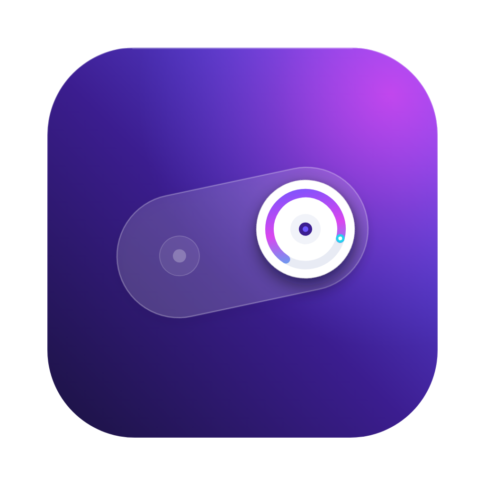

<p align="center">
  
</p>

<h1 align="center">Quotaro</h1>

<p align="center">
  Switch AI coding accounts, watch every usage limit, and talk to your running agents, all from one desktop app.
  <br>
  For <b>Claude Code</b> and <b>Codex</b>, on macOS, Linux and Windows.
</p>

---

## Why

If you use more than one Claude Code or Codex login (work and personal, or several plans), you end up juggling config folders, guessing how much of each limit is left, and waiting for windows to reset. Quotaro handles that:

- **One click to switch.** Every new terminal command uses the account you picked.
- **Every limit in view.** 5-hour and weekly usage per account, with a countdown to each reset.
- **No wasted windows.** Get a notification when a limit resets, or have Quotaro start your next session the minute it does.

## Features

| | |
|---|---|
| **Accounts** | Each Claude Code or Codex login lives in its own folder. Your existing login appears as the main account. Give each account a name and an icon. |
| **Switching** | One click switches the account for your terminals. Already-open terminals pick it up at their next prompt. |
| **Usage limits** | Live 5-hour and weekly rings for every account, with reset countdowns. Logins that share one Claude account share one reading. |
| **Reset alerts** | A bell on any limit sends a system notification the moment it resets. |
| **Auto-start at reset** | Sends a short message a minute after each 5-hour reset, so your next window starts right away instead of when you next remember. |
| **Stats** | A chart of usage over time per account (24 hours, 7 days or 30 days), backfilled from logs already on your machine. |
| **Agents** | Your Claude Code and Codex chats from the last 7 days, with live ones marked. Read them, reply to them, or start a new background agent in any folder. |
| **Move a chat** | Continue a Claude Code chat on another account: Quotaro copies it over and resumes it there in a terminal. |
| **Tray** | Quotaro keeps running in the menu bar or system tray, with a quick account switcher. |

## Install

There are no prebuilt downloads yet, so build Quotaro from source.

**You need:** [Node.js](https://nodejs.org) 22.18 or newer, and [Claude Code](https://docs.anthropic.com/en/docs/claude-code) and/or [Codex](https://github.com/openai/codex) on your `PATH`.

```sh
git clone https://github.com/SandunYL/quotaro.git
cd quotaro
npm install
npm run dist       # builds an installer for your OS into dist/
```

Or run it straight from source with `npm run dev`.

## Getting started

1. **Open Quotaro.** Your current Claude Code and Codex logins show up on their own. Accounts from [AccountDeck](https://github.com/nadim-sheikh/accountDeck) are imported too.
2. **Connect your terminal.** Click **Connect** on the banner. This adds a small hook to `~/.zshrc` or `~/.bashrc`; open a new terminal window once.
3. **Turn on usage tracking** for each Claude Code account. Numbers appear after that account's next reply.
4. **Add more accounts** with **+ Add account**. A terminal opens so you can sign in; the new login gets its own folder and your main login stays untouched.
5. **Switch** on any card. Every new command in every terminal now uses that account.

> A Claude Code session that is already running keeps its account. Quit it and start `claude` again, or use **Continue there** in Agents to take the chat with you.

## How it works

Quotaro reads files that Claude Code and Codex already write. It doesn't call any API itself.

| What | Where it comes from |
|---|---|
| Claude Code limits | The JSON Claude Code passes to its status line, saved per session by a small hook script |
| Codex limits | The `rate_limits` entries in Codex's session logs |
| Exact limits after an agent run | The rate-limit event Claude Code reports while it runs |
| Account email | `.claude.json` for Claude Code; for Codex, the email inside the ID token in `auth.json`, decoded on your machine |
| Chats | Claude Code transcripts in `projects/` and Codex rollout logs in `sessions/` |
| Switching | `CLAUDE_CONFIG_DIR` and `CODEX_HOME`, set by a shell hook (Windows: user environment variables) |

Agents run through the official CLIs (`claude -p`, `codex exec`). Each run uses that account's own permission settings.

## What Quotaro changes on your machine

Everything is opt-in, and every edit to a file you own is backed up first.

- **`~/.switch-man/`** holds Quotaro's own data: accounts, the active-account file, usage history and added accounts' folders. The name dates from the app's working title; it stays so existing setups keep working.
- **`~/.zshrc` / `~/.bashrc`:** one marked block, added when you click **Connect**. It is appended, so a symlinked rc file stays a symlink. A one-time backup is kept next to it.
- **Each Claude Code account's `settings.json`:** the status line is wrapped when you turn on tracking. Your own status line keeps running unchanged. A one-time backup is kept.
- **Removing an account** moves its folder to the Trash. Folders Quotaro didn't create (such as imported ones) are never deleted.

## Privacy

- Everything stays on your computer. Quotaro has no server, no analytics and no telemetry.
- Access and refresh tokens are never read, sent or refreshed. The only sign-in data Quotaro uses is the account email shown on each card. For Codex that email is decoded locally from the ID token.
- Agent runs and auto-start messages go to Anthropic or OpenAI through their own CLIs, exactly as if you had typed them.

## Platform support

| | macOS | Linux | Windows |
|---|:---:|:---:|:---:|
| Accounts, limits, alerts, stats, agents | ✅ | ✅ | ✅ |
| Switching in open terminals | zsh, bash | zsh, bash | new terminals only |
| Open at login | ✅ | — | ✅ |
| Tested on real hardware | ✅ | not yet | not yet |

fish and other shells aren't supported yet.

## Development

```sh
npm install
npm run dev         # app with hot reload
npm run typecheck
npm test            # parser and hook tests (Node's built-in test runner)
npm run build       # production build into out/
npm run dist        # installer for the current OS
```

Built with Electron, React, TypeScript, Tailwind CSS and Motion. The app icon was designed in [Google Stitch](https://stitch.withgoogle.com).

```
src/main/       main process: accounts, usage parsing, agents, tray, timers
src/preload/    the bridge the UI calls through
src/renderer/   React UI (Overview, Agents, Stats, Settings)
src/shared/     types shared by both sides
build/          app icon (SVG source and 1024 px PNG)
```

## Roadmap

- Claude Desktop and ChatGPT accounts
- Moving Codex chats between accounts
- Copying MCP servers and settings between accounts
- fish shell support
- Signed, prebuilt releases

## Credits

Quotaro started from [AccountDeck](https://github.com/nadim-sheikh/accountDeck) by Nadim Sheikh (MIT). [docs/accountdeck-features.md](docs/accountdeck-features.md) maps everything it does.

## License

[MIT](LICENSE)
